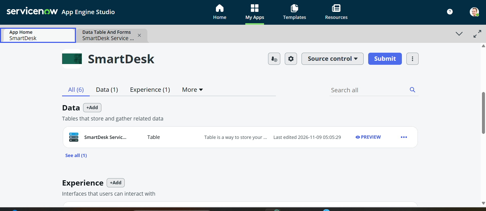
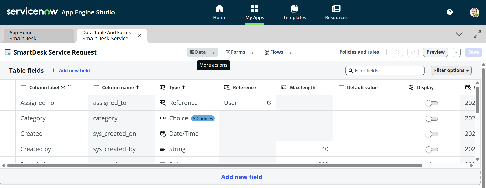
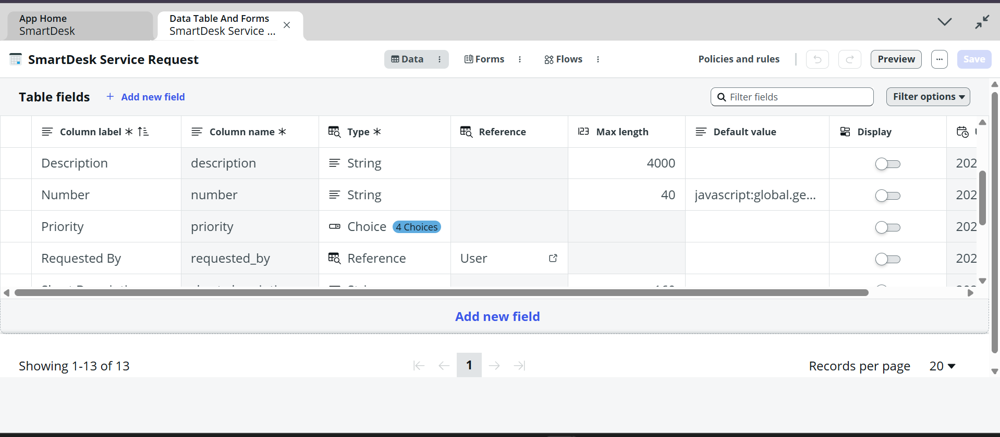
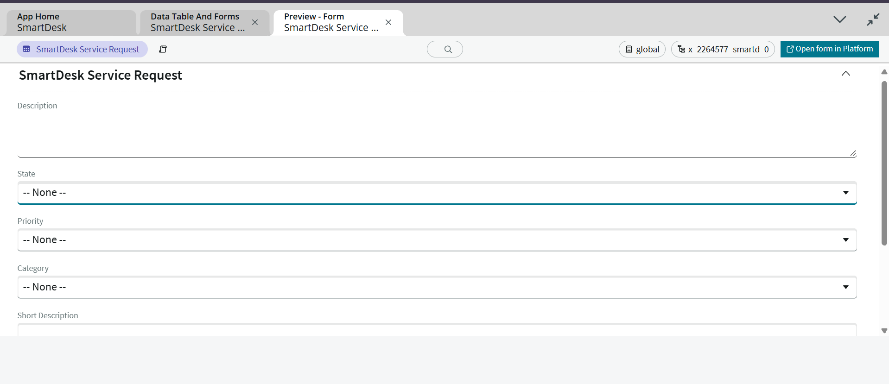
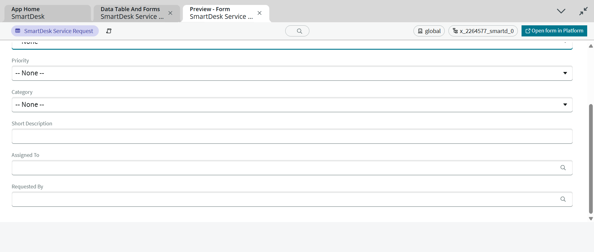
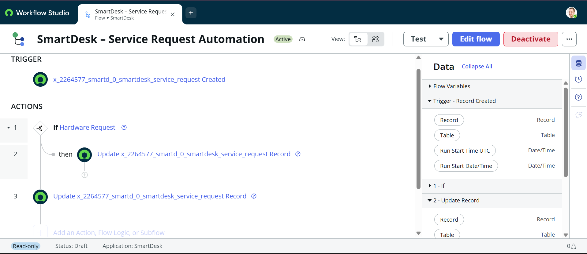
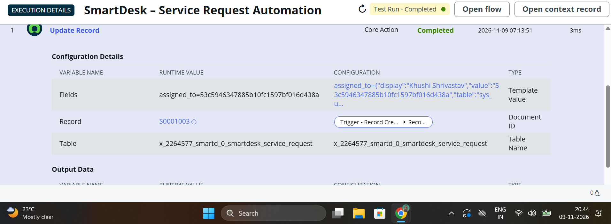

# SmartDesk – Service Request Management & Automation

SmartDesk is a ServiceNow application I'm building to make IT service requests easier to create, manage and track.

The idea is simple: instead of handling every request manually, users can submit a service request through one place, while agents can manage the requests and use automated workflows to reduce repetitive work.

I built the initial application using **ServiceNow App Engine Studio** and **Flow Designer**. I'm also working towards extending it with more intelligent automation.

## Project Overview

SmartDesk is designed around a simple service request management process:

1. A user creates a service request.
2. The request is stored in a custom ServiceNow table.
3. The request contains details such as category, priority and description.
4. A Flow Designer workflow is triggered when a new request is created.
5. The workflow updates the request record automatically.

The current version covers the basic application and record-triggered automation. Additional workflow improvements are part of the development roadmap.

## Technologies Used

- **ServiceNow App Engine Studio** – Application development
- **ServiceNow Flow Designer** – Workflow automation
- **ServiceNow Tables** – Storing and managing service request records
- **ServiceNow Forms** – Creating and updating request details

## Features Implemented

- Created a custom ServiceNow application named **SmartDesk**.
- Created a custom **SmartDesk Service Request** table.
- Configured fields to capture request information.
- Designed a form for creating and viewing service requests.
- Set up application roles and table-level permissions.
- Created a record-triggered Flow Designer workflow.
- Added an Update Record action to automatically update the assigned user.
- Tested the workflow using sample service request records.
- Checked Flow Designer execution details to confirm that the workflow completed successfully.

## Service Request Table

The custom table stores the information required to manage each request.

| Field | Purpose |
|---|---|
| Number | Unique service request number |
| Requested By | User who submitted the request |
| Short Description | Brief summary of the issue |
| Description | Detailed explanation of the request |
| Category | Type of service request |
| Priority | Importance of the request |
| State | Current status of the request |
| Assigned To | User responsible for handling it |

### Request Categories

The application is configured with the following categories:

- Hardware
- Software
- Network
- Access
- Other

### Priority Levels

- Low
- Medium
- High
- Critical

### Request States

- New
- In Progress
- On Hold
- Resolved
- Closed

## Application Roles and Permissions

I configured three application roles to separate access based on the user's responsibilities.

| Role | Configured table permissions |
|---|---|
| Admin | Create, Read, Write and Delete |
| Agent | Create, Read and Write |
| User | Create and Read |

These are the table-level permissions configured for the application. More detailed access control can be added as the project develops.

## Flow Designer Automation

One of the main parts of SmartDesk is its use of ServiceNow Flow Designer.

### Current Workflow

The workflow is named **SmartDesk – Service Request Automation**.

**Trigger:** Record Created on the SmartDesk Service Request table.

**Action:** Update Record on the newly created request.

The current flow updates the Assigned To field with a configured ServiceNow user.

### Workflow Process

```text
New Service Request Created
           |
           v
   Flow Designer Trigger
           |
           v
      Update Record
           |
           v
  Assigned To is Updated
           |
           v
    Workflow Completed
```

I tested the flow using sample request records and checked the execution details to verify that the Update Record action completed successfully.

## Planned Automation Enhancements

I don't want SmartDesk to remain just a basic request form. The next stage is to make the application handle more of the routine work automatically.

The following improvements are planned:

- [ ] **Category-based assignment:** Automatically assign requests to the appropriate person or team based on whether the request is related to Hardware, Software, Network, Access or another category.
- [ ] **Priority-based handling:** Introduce different handling paths for High and Critical requests so that urgent issues can receive attention first.
- [ ] **Email notifications:** Send automatic notifications when a request is created or assigned.
- [ ] **Improved status management:** Extend the workflow to support request progress and resolution.
- [ ] **Additional workflow testing:** Test different request categories, priorities and scenarios to make sure the automation behaves correctly.

These features are part of the planned development and are not all implemented yet.

## What I Learned

While building SmartDesk, I got practical experience with:

- Creating scoped applications using App Engine Studio.
- Creating custom tables and configuring fields.
- Working with reference fields and choice fields.
- Designing forms in ServiceNow.
- Understanding application roles and table permissions.
- Creating record-based triggers in Flow Designer.
- Using Update Record actions and data pills.
- Testing flows and checking execution details.

## Project Structure

The repository will be organised as the project documentation and screenshots are added.

```text
SmartDesk-Service-Request-Automation/
│
├── README.md
│
├── Screenshots/
│   ├── application-home.png
│   ├── service-request-table.png
│   ├── request-form.png
│   └── flow-designer.png
│
├── Documentation/
│   ├── Project-Overview.md
│   ├── Workflow-Documentation.md
│   └── Testing-and-Results.md
│
└── Diagrams/
    └── workflow-diagram.png
```

## Current Project Status

**In progress**

The initial SmartDesk application, custom table, form and basic Flow Designer automation have been created and tested. I'm continuing to improve the workflow with category-based assignment, priority handling and notifications.

## Repository

[SmartDesk – Service Request Management & Automation](https://github.com/Khush-EE/SmartDesk-Service-Request-Automation)

---

*This project is being developed as a hands-on way to learn ServiceNow application development, workflow automation and IT service management concepts.*


## Project Screenshots

### 1. SmartDesk Application Home


### 2. Custom Service Request Table




### 3. Service Request Form




### 4. Flow Designer Automation


### 5. Successful Automation Execution

